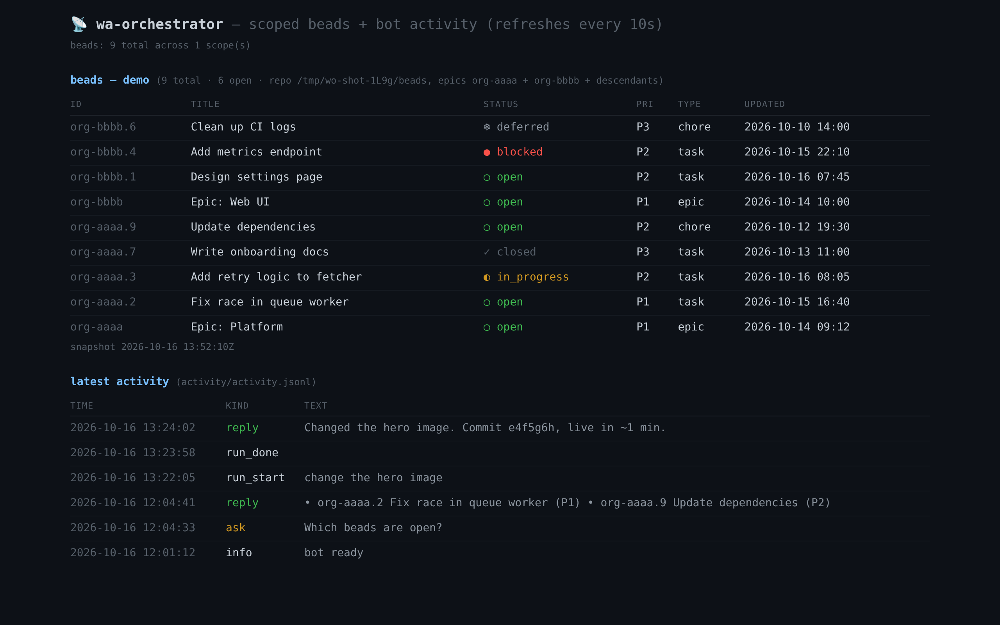

# wa-orchestrator

**One process, one WhatsApp account, N groups, one brain per group.**

wa-orchestrator is a multi-group WhatsApp bot: a
[whatsapp-web.js](https://github.com/pedroslopez/whatsapp-web.js) client
(Chromium + Xvfb) listens on registered groups and delegates every request to
a **brain = a [pi](https://pi.dev) 1.2.0 agent running inside a sandboxed
Docker container**, with a locked LLM model.

The orchestrator is extensible by construction: **adding a group = one
registry entry**, adding a capability = one brain profile.

Source is TypeScript in `src/` (compiled to `dist/` by `npm run build`);
all runtime entry points live in `dist/`.

```
 WhatsApp ──wwebjs──▶ index.js ──per group──▶ brain.js ──docker──▶ container
 (1 account)          registry                docker run            pi agent
                                              wa-orchestrator-     ├── /workspace = the group's own work dir
                                              sandbox              ├── /beads     = beads repo (`bd` via BEADS_DIR)
                                                                    ├── tools (git, hugo, …)
                                                                    ├── subagent (in-process child agents)
                                                                    ├── herdr (host server over a mounted socket)
                                                                    └── 1 brain ≠ 1 group
```

## Brains (profiles)

| profile | free-text `pi …` | run modes |
|---|---|---|
| `beads-project` | list/create beads by label in a beads repo | `pi run <bead>` → executes the bead, artifacts → `task/<id>` branch |
| `site-project` | scoped read-only beads (a live Dolt DB, filtered to a set of epics) | `pi edit <instruction>` → edits the site checkout, verifies the build, **commit + push** to `origin/main` |

The brain is chosen **per group** (the `brain` field of the registry) — not
per message, not per server.

**Every group gets its own work area**: each brain profile sets a
`workspaceDir` (e.g. `workspaces/<brain>/`), mounted at `/workspace`. Brains
never operate inside a shared project repo; the beads DB is a *separate*
`/beads` mount and `BEADS_DIR` makes the bare `bd` CLI resolve it from any
cwd.



*Dashboard (`:8093`, zero dependencies): scoped beads per `cpo` brain profile
+ latest bot activity. Screenshot uses synthetic fixture data.*

## Quickstart

Prereqs: `docker`, `xvfb` (`xvfb-run`), system Chromium, node ≥ 22.

```bash
npm install            # also runs `npm run build` (tsc → dist/)
# 1. Sandbox image (pi 1.2.0, bd, jq, hugo_extended + the pinned pi packages:
#    provider, ask-questions, pi-subagents, pi-herdr + herdr client — Dockerfile)
bash sandbox/build.sh
# 2. Config: start from the template, fill in JIDs + absolute paths
cp config.template.json config.json
#    (override the path with WO_CONFIG=/abs/path/config.json if needed)
#    A group's JID shows up in the log of its first message, or run
#    `npm run discover` (xvfb-run -a node dist/discover.js) in a maintenance window
# 3. Services (template units provided, user-scoped — fill <HOME>/<NODE_BIN>)
cp wa-orchestrator.service wa-orchestrator-dashboard.service ~/.config/systemd/user/
systemctl --user daemon-reload
systemctl --user enable --now wa-orchestrator wa-orchestrator-dashboard
```

The WhatsApp session lives in `sessions/` (LocalAuth). **One client per
account**: never run two instances at the same time (a previous bot using the
same account included).

Prompts are loaded from `brain-prompts.json` (gitignored, per deployment);
start from `brain-prompts.template.json`. Without it the bot falls back to
minimal generic built-in prompts and logs a warning.

## Extending

### Adding a group
1. Get the JID (from an inbound message, or `npm run discover`).
2. Add `{"jid": "...@g.us", "name": "My group", "brain": "site-project"}` to
   `groups[]` in `config.json`.
3. Restart the service. That's it.

### Conversations (continuous memory per group)

Each registered **group** holds one continuous conversation, persisted as a
pi session under the brain profile's `conversationDir`:
`<conversationDir>/<group-slug>/<created>_<slug>.jsonl` (one dir per group).

- **First turn** of a conversation renders the full prompt (`*.ask.first`);
  **later turns** render a slim continuation (`*.ask.turn`) — the session file
  already holds the first-turn context.
- Run-mode calls (`run` / `edit`) land in the **same** group conversation:
  a member can ask, order an edit, and check the result across messages.
- **Reset**: send `pi new` in the group — the session dir is renamed aside
  and the next message starts a fresh first turn. Deleting the dir = amnesia;
  the bot keeps running.
- Containers stay disposable (`docker run --rm`): continuity is the session
  *file*, and the model lock is re-verified on every start, resumed sessions
  included.

### Multi-agent primitives (delegation)

The sandbox bakes in two pinned delegation layers on top of pi:

- **`subagent` tool** ([`pi-subagents`](https://www.npmjs.com/package/pi-subagents), in-process):
  the brain can launch child agents — `scout` to find, `reviewer` to check,
  `worker` to build, `oracle` to consult, `delegate` for simple sub-tasks —
  that run in the *same* sandbox under the *same* constraints and model lock.
  Children are **blocking by default** (the one-shot RPC brain is killed on
  settle, so a detached child would die mid-work); parallel children are
  allowed. Config is materialized per run
  (`extensions/subagent/config.json`: `{"asyncByDefault": false,
  "toolActivation": "eager"}` — eager, because the default "auto" mode hides
  the tool in resumed sessions).
- **herdr tools** ([`pi-herdr`](https://www.npmjs.com/package/@andrewjacop/pi-herdr),
  host panes): `herdr_spawn_agent` starts a **visible agent pane on the
  operator's machine** — the in-container herdr client talks to the *host*
  herdr server over a single bind-mounted socket (`herdrSocketPath`), and
  `herdr_wait_output` / `herdr_get_agent_result` collect, `herdr_message_agent`
  steers, `herdr_interrupt_agent` stops. Panes are **host-owned**: they
  survive the disposable `docker --rm` brain runs, and a human can watch and
  type in them from the herdr TUI. `herdrSpawnPane` pins a dedicated home
  pane (a workspace of its own) as the spawn target so bot agents stay out of
  the operator's live work.

Host side (required for herdr children to actually start):

```bash
# 1. herdr server kept alive by the herdr.service user unit (template in this
#    repo; starts only if none running, Restart=on-failure, lingering).
# 2. pi-herdr installed ONCE on the host, self-contained (org-5mdy.1): the
#    launch plan injects <pkg>/src/child.ts into the child pi, which runs in a
#    HOST pane — the package must live at a host-equal path.
mkdir -p ~/.local/share/wa-orchestrator/pi-herdr && cd $_
npm init -y && npm i @andrewjacop/pi-herdr@0.6.0
# then set "herdrPkgDir" in config.json; brain.ts mounts it onto itself and
# loads it in-sandbox from the same absolute path.
```

Without `herdrSocketPath`/`herdrPkgDir` the herdr tools simply fail
in-sandbox and the brain falls back to in-process subagents.

### Clarifying questions (structured Q&A in the group)

When a requirement is blurry, the brain can ask the **group** a structured
question instead of guessing. The sandbox ships the
[`@adeildo/pi-ask-questions`](https://www.npmjs.com/package/@adeildo/pi-ask-questions)
extension (pinned, loaded via the local-path `packages` list), which gives pi
an `ask_questions` tool:

1. The brain calls `ask_questions` → pi emits an `extension_ui_request`
   (RPC) → the bot posts the question in the group, options numbered
   (plus a "Type something." row for free text).
2. The **next member message in that group** is the answer: a number picks
   that exact option; free text takes the typed row. The run's timeout is
   paused while the group is being asked.
3. No answer within `questionTimeoutMs` (default 30 min) → the question is
   cancelled and the brain continues (or reports the lack of decision).

Activity log gains `question_asked` / `question_answered` /
`question_timeout` entries.

### Adding a brain
Add a profile to `brains{}` in `config.json` (repo paths, prompts file
entries, run mode) and point a registry entry at it. Give it its own
`workspaceDir` (one per group — never a shared project repo) and a
`beadsRepoDir` (mounted at `/beads`); `herdrSocketPath`/`herdrSpawnPane`
activate the host-herdr tools when set.

## Security

- **Every member of a registered group can command the bot** (no per-member
  auth) — accepted by design.
- Write-capable run modes (e.g. `pi edit` → push to production) are **scoped
  in the in-container prompt**: minimal edits, mandatory build before push,
  never force-push, never touch `.github/`.
- Git credentials for run modes are **materialized inside the container**
  (`sandbox/git-home/`), never in the repo.
- Everything is traced: `activity/activity.jsonl` (asks, replies, run modes)
  + dashboard on `:8093`.
- The repo contains **no secrets**: `config.json` and `brain-prompts.json`
  are gitignored; only `config.template.json` and `brain-prompts.template.json`
  (placeholders) are published.

## Operations

```bash
systemctl --user status wa-orchestrator wa-orchestrator-dashboard
journalctl --user -f -u wa-orchestrator
curl -s localhost:8093/healthz          # → ok
npm run test-brain -- --profile site-project "Which beads are open?"
# Full self-test (env): the bot pings each listed group through itself
SELFTEST_GROUP="Group A,Group B" node dist/index.js
```

**Rollback**: stop `wa-orchestrator` and start the previous unit — same
account, same session, no re-QR.

## Developers

- **TypeScript**: sources in `src/` (`strict`, CommonJS output to `dist/`).
  `npm run build` after editing; `npm test` runs the `node:test` suite in
  `test/` against the compiled output.
- `npm pack` prepares the package; publishing happens from a machine holding
  an npm token (`npm publish`). It is distributed as a **pi package**
  (keyword `pi-package`, `pi` manifest): `pi install npm:wa-orchestrator`
  installs the daemon + the operations skill.
- Static docs: `docs/` → published to GitHub Pages by
  `.github/workflows/deploy-docs.yml` (branch `gh-pages`).
